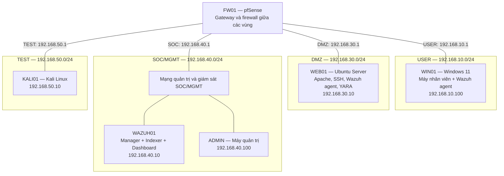
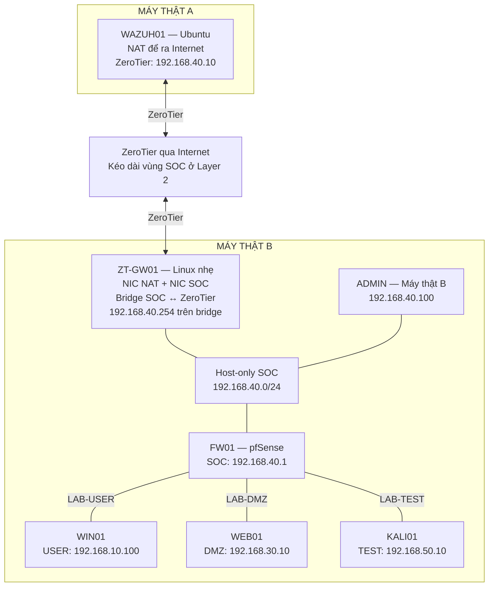
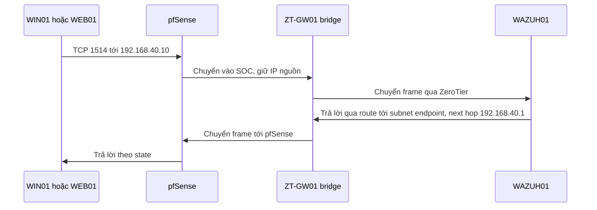

# ĐỀ XUẤT THIẾT KẾ MẠNG VÀ TRIỂN KHAI WAZUH TRÊN HAI MÁY THẬT

**Môn học:** Hệ thống tìm kiếm, phát hiện và ngăn ngừa xâm nhập  
**Đề tài:** A21 – Wazuh, triển khai nền tảng Endpoint Protection  
**Ngày lập:** 16/10/2026  
**Nền tảng:** Oracle VirtualBox và ZeroTier  
**Trạng thái:** Thiết kế và kế hoạch triển khai; chưa phải báo cáo kết quả thực nghiệm.

**Cập nhật 19/10/2026:** bổ sung hướng dẫn cài, đăng ký và nghiệm thu Agent trên từng endpoint tại mục 10.1–10.7. Đây là hướng dẫn thực hiện, chưa xác nhận WIN01/WEB01 đã được cài hoặc kiểm thử. Phần mạng VirtualBox bên dưới thuộc phương án thiết kế ban đầu; nếu máy B đang dùng VMware Workstation, giữ IP/vai trò mạng nhưng ánh xạ sang VMnet tương ứng, không chạy lệnh VBoxManage trên máy B.

> Sơ đồ trong tài liệu dùng Mermaid. Mở bằng trình xem Markdown hỗ trợ Mermaid để hiển thị hình. Tên interface, phiên bản và thông số tài nguyên phải được xác nhận khi dựng VM thực tế.

## 1. Mục tiêu và phạm vi

Mô phỏng mạng doanh nghiệp nhỏ có máy nhân viên Windows, máy chủ dịch vụ Linux, firewall phân vùng và hệ thống giám sát tập trung bằng Wazuh. Một máy trạm đại diện cho nhóm nhân viên có cùng chính sách; không cần dựng đầy đủ số lượng nhân viên của doanh nghiệp.

Do một máy thật không đủ RAM và dung lượng đĩa, các thành phần được phân bổ:

- **Máy thật A:** chạy VM WAZUH01, gồm manager/server, indexer và dashboard.
- **Máy thật B:** chạy pfSense, Windows nhân viên, Linux dịch vụ, Kali kiểm thử và một Linux nhẹ làm cầu nối ZeroTier.
- **ZeroTier:** nối vùng SOC ở máy B với Wazuh ở máy A qua Internet.

Năm tính năng chính:

1. Giám sát toàn vẹn tập tin – File Integrity Monitoring (FIM).
2. Phát hiện dò mật khẩu SSH, kết hợp phản ứng chặn IP có thời hạn.
3. Phát hiện lỗ hổng từ thông tin phần mềm và dữ liệu CVE.
4. Tích hợp VirusTotal và tự động loại tập tin được xác định trong kịch bản thử nghiệm.
5. Phát hiện tập tin theo bộ quy tắc YARA.

Thu thập log, kết nối agent, đồng bộ thời gian và tra cứu dashboard là nền tảng phục vụ các tính năng trên. Log pfSense bổ sung ngữ cảnh mạng. Active Directory, Shuffle, MISP và Suricata là hướng mở rộng, chưa đưa vào phạm vi triển khai chính.

## 2. Bối cảnh doanh nghiệp mô phỏng

Nhân viên sử dụng máy Windows để xử lý tài liệu và truy cập website doanh nghiệp. Website chạy trên Linux trong vùng dịch vụ tách biệt. Bộ phận IT theo dõi sự kiện tập trung, phát hiện thay đổi tập tin, đăng nhập bất thường, phần mềm có lỗ hổng và các tập tin khớp dấu hiệu nhận diện.

Máy Kali thuộc vùng kiểm thử của lab, không phải thiết bị nghiệp vụ của doanh nghiệp. Máy cầu nối ZeroTier thuộc hạ tầng triển khai lab, không thay thế firewall hay máy chủ dịch vụ.

## 3. Phân vùng mạng

| Vùng | Subnet | Vai trò |
| --- | --- | --- |
| USER | `192.168.10.0/24` | Máy nhân viên Windows |
| DMZ | `192.168.30.0/24` | Máy chủ website và SSH |
| SOC/MGMT | `192.168.40.0/24` | Wazuh, quản trị và cầu nối giữa hai máy thật |
| TEST | `192.168.50.0/24` | Máy tạo hoạt động kiểm thử |

pfSense là gateway giữa các vùng. Trong VirtualBox, các vùng được mô phỏng bằng những mạng Layer 2 riêng; thiết kế này **không yêu cầu gắn thẻ VLAN 802.1Q**. DMZ biểu diễn vùng dịch vụ tách biệt; website ban đầu chỉ cần phục vụ nội bộ, chưa công bố ra Internet.

## 4. Sơ đồ mạng logic



Đường nối biểu diễn kết nối mạng, không có nghĩa mọi lưu lượng đều được phép. Lưu lượng giữa USER, DMZ, TEST và SOC đi qua chính sách pfSense. Lưu lượng giữa các thiết bị cùng SOC không đi qua pfSense; phải áp dụng quyền ứng dụng và firewall trên máy đích.

## 5. Sơ đồ triển khai trên hai máy thật



### 5.1. Vai trò của cầu nối

ZT-GW01 nối interface ZeroTier với NIC thuộc SOC bằng Linux bridge. NIC NAT của ZT-GW01 **không** tham gia bridge; nó chỉ cung cấp kết nối Internet cho máy cầu nối.

Thiết kế có **6 VM tổng cộng**: máy A có 1 VM; máy B có 5 VM. VM thứ sáu là phần hạ tầng bổ sung để kéo dài mạng giữa hai host. Chỉ cài ZeroTier trên hai máy thật không tự nối được các Internal Network của VM.

Không cần cài ZeroTier trên WIN01, WEB01, KALI01 hoặc pfSense. Các endpoint tiếp tục dùng pfSense làm gateway, giữ được IP nguồn và phạm vi phân vùng đã thiết kế.

### 5.2. Tách đường vận chuyển và đường dữ liệu lab

- **Vận chuyển ZeroTier:** WAZUH01 và ZT-GW01 dùng NIC NAT của từng VM để ra Internet.
- **Dữ liệu giám sát:** endpoint → pfSense → SOC → ZT-GW01 → ZeroTier → WAZUH01.
- **Truy cập Internet của endpoint:** đi qua WAN pfSense.
- **Truy cập Internet của WAZUH01:** dùng NAT trực tiếp cho cập nhật, CTI, VirusTotal và vận chuyển ZeroTier.

Đây là ngoại lệ triển khai do Wazuh nằm trên host khác. Không mô tả rằng mọi kết nối Internet của Wazuh đều đi qua pfSense. Không chuyển default route của Wazuh vào chính đường hầm ZeroTier, vì đường hầm cần giữ kết nối Internet nền để hoạt động.

## 6. Bảng địa chỉ và tài nguyên

### 6.1. Địa chỉ IP

| Máy/interface | IP/mask | Gateway hoặc đường đi |
| --- | --- | --- |
| FW01 — WAN | DHCP từ VirtualBox NAT | Gateway do NAT cấp |
| FW01 — USER | `192.168.10.1/24` | Không đặt upstream gateway |
| FW01 — DMZ | `192.168.30.1/24` | Không đặt upstream gateway |
| FW01 — SOC | `192.168.40.1/24` | Không đặt upstream gateway |
| FW01 — TEST | `192.168.50.1/24` | Không đặt upstream gateway |
| WIN01 | `192.168.10.100/24` | `192.168.10.1` |
| WEB01 | `192.168.30.10/24` | `192.168.30.1` |
| KALI01 | `192.168.50.10/24` | `192.168.50.1` |
| ADMIN — Host-only máy B | `192.168.40.100/24` | Để trống trên NIC Host-only |
| ZT-GW01 — bridge `br-soc` | `192.168.40.254/24` | Default route giữ trên NIC NAT |
| ZT-GW01 — NIC NAT | DHCP | Theo NAT |
| WAZUH01 — ZeroTier | `192.168.40.10/24` | Ba subnet lab qua `192.168.40.1` |
| WAZUH01 — NIC NAT | DHCP | Default route giữ theo NAT |

Đổi subnet trước khi triển khai nếu trùng mạng thật hoặc VPN hiện có. Dùng DNS/NTP của pfSense cho endpoint sau khi đã bật dịch vụ và cho phép truy cập. Wazuh và ZT-GW01 có thể giữ DNS từ NIC NAT. Đồng bộ giờ và lưu múi giờ khi đối chiếu sự kiện.

### 6.2. Tài nguyên dự kiến

| Host | VM | vCPU | RAM | Đĩa ảo |
| --- | --- | ---: | ---: | ---: |
| A | WAZUH01 | 4 | 8 GiB | 80 GB |
| B | FW01 | 2 | 2 GiB | 20 GB |
| B | WIN01 | 2 | 4 GiB | 64 GB |
| B | WEB01 | 2 | 2 GiB | 30 GB |
| B | KALI01 | 2 | 2 GiB | 30 GB |
| B | ZT-GW01 | 1 | 1–2 GiB | 12 GB |

Máy A cấp khoảng 8 GiB RAM và 80 GB đĩa ảo; máy B cấp khoảng 11–12 GiB RAM và 156 GB đĩa ảo. Đây là phân bổ dự kiến, chưa xác nhận cấu hình hai host. Phải chừa tài nguyên cho hệ điều hành thật, cập nhật và snapshot. Đĩa cấp phát động chỉ giảm dung lượng dùng ban đầu; không loại bỏ nhu cầu dung lượng khi dữ liệu tăng.

Wazuh Quickstart khuyến nghị 4 vCPU, 8 GiB RAM và 50 GB cho nhóm 1–25 agent theo giả định lưu trữ của tài liệu. Đề xuất tăng đĩa lên 80 GB để dự phòng cho lab. Xem [Quickstart](https://documentation.wazuh.com/current/quickstart.html).

## 7. Cấu hình mạng VirtualBox

### 7.1. Máy thật A

| VM | Adapter | Kiểu mạng | Ghi chú |
| --- | --- | --- | --- |
| WAZUH01 | 1 | NAT | Ubuntu nhận Internet; cài ZeroTier bên trong VM |

Interface ZeroTier là interface phần mềm trong Ubuntu, không phải adapter thứ hai của VirtualBox. Địa chỉ `192.168.40.10` được gán cho interface ZeroTier, không gán vào NIC NAT.

### 7.2. Máy thật B

| VM | Adapter | Kiểu mạng | Tên/vai trò |
| --- | --- | --- | --- |
| FW01 | 1 | NAT | WAN |
| FW01 | 2 | Host-only Adapter | SOC |
| FW01 | 3 | Internal Network | `LAB-USER` |
| FW01 | 4 | Internal Network | `LAB-DMZ` |
| FW01 | 5 | Internal Network | `LAB-TEST` |
| WIN01 | 1 | Internal Network | `LAB-USER` |
| WEB01 | 1 | Internal Network | `LAB-DMZ` |
| KALI01 | 1 | Internal Network | `LAB-TEST` |
| ZT-GW01 | 1 | NAT | Internet cho ZeroTier |
| ZT-GW01 | 2 | Host-only Adapter | Cùng SOC với FW01 |

Thực hiện trên máy B:

1. Tạo Host-only Adapter, gán IP host `192.168.40.100/24`, không đặt default gateway và tắt DHCP tích hợp trên mạng này.
2. Chọn đúng cùng Host-only Adapter cho pfSense và ZT-GW01.
3. Dùng đúng tên Internal Network giữa pfSense và VM tương ứng.
4. Với adapter SOC của ZT-GW01, đặt **Promiscuous Mode: Allow All** để bridge nhận được frame mang MAC của thiết bị phía bên kia. NIC NAT không cần chế độ này.
5. Gán interface pfSense theo địa chỉ MAC, không suy đoán tên interface từ số thứ tự adapter.
6. Không thêm NIC NAT trực tiếp cho WIN01, WEB01 hoặc KALI01 trong lúc kiểm chứng phân vùng.

VirtualBox hỗ trợ đến tám NIC cho một VM, nhưng giao diện thông thường hiển thị bốn NIC đầu. Cấu hình adapter thứ năm của FW01 bằng VBoxManage khi VM tắt. Ví dụ VirtualBox 7.2, chạy trên máy B và sửa tên VM/đường dẫn nếu khác:

```powershell
& "C:\Program Files\Oracle\VirtualBox\VBoxManage.exe" modifyvm "FW01" --nic5=intnet --intnet5="LAB-TEST" --nic-type5=82540EM --cable-connected5=on
```

Tham khảo [Virtual Networking](https://docs.oracle.com/en/virtualization/virtualbox/7.2/user/networkingdetails.html). Internal Network và Host-only không tự kéo dài sang host khác dù đặt cùng tên.

## 8. Thiết kế kết nối ZeroTier

### 8.1. Thành viên và địa chỉ

Tạo một network ZeroTier riêng cho SOC. Chỉ cần hai thành viên chính:

| Thành viên | Cấu hình |
| --- | --- |
| WAZUH01 | Được phê duyệt; địa chỉ quản lý `192.168.40.10/24`; không cấp quyền bridge |
| ZT-GW01 | Được phê duyệt; bật quyền Ethernet bridging; không tự gán IP trên interface ZeroTier |

Đặt managed route trực tiếp `192.168.40.0/24`, không có next hop. Không cấp default route qua ZeroTier. Không cho pool tự cấp trùng `.1`, `.10`, `.100` hoặc `.254`; có thể tắt auto-assign và gán tường minh cho Wazuh. Trên GW, IP SOC đặt ở bridge, không đặt đồng thời ở NIC SOC và interface ZeroTier.

Chỉ dùng `.254` làm IP quản trị bridge; **gateway của endpoint vẫn là pfSense `.1`**. GW thực hiện bridge Layer 2, không NAT lưu lượng lab và không thay vai trò định tuyến của pfSense.

### 8.2. Tham gia mạng

Cài ZeroTier từ nguồn chính thức trên WAZUH01 và ZT-GW01. Trên từng VM, thay Network ID thật rồi chạy:

```bash
sudo zerotier-cli join NETWORK_ID
sudo zerotier-cli listnetworks
```

Phê duyệt thành viên trong trang quản trị. Trên ZT-GW01, tắt việc ZeroTier tự quản lý địa chỉ và route của interface sẽ đưa vào bridge:

```bash
sudo zerotier-cli set NETWORK_ID allowManaged=0
```

Trên Wazuh, giữ quản lý địa chỉ bật để nhận `.10/24`. Tên interface `zt...` phải lấy từ `listnetworks` hoặc `ip -br link`. Không cấu hình bridge trên Windows host. Thiết kế bridge trên Linux dựa trên [ZeroTier Layer 2 Bridge](https://docs.zerotier.com/bridging/).

### 8.3. Cấu hình bridge trên ZT-GW01

Ví dụ dùng Ubuntu Server với Netplan và systemd-networkd. Giả sử NIC NAT là `enp0s3`, NIC SOC là `enp0s8`. Xác minh bằng MAC và `ip -br link` trước khi áp dụng. Hợp nhất với cấu hình Netplan hiện có để tránh nhiều file khai báo xung đột cùng interface.

```yaml
network:
  version: 2
  renderer: networkd
  ethernets:
    enp0s3:
      dhcp4: true
    enp0s8:
      dhcp4: false
      optional: true
  bridges:
    br-soc:
      interfaces: [enp0s8]
      addresses: [192.168.40.254/24]
      parameters:
        stp: false
        forward-delay: 0
```

Áp dụng từ console VirtualBox với `sudo netplan try`, xác nhận bridge có `.254` và NIC NAT vẫn giữ default route. Thêm cấu hình networkd riêng `/etc/systemd/network/05-zerotier-soc.network`; thay tên interface ZeroTier thực tế:

```ini
[Match]
Name=ztTEN_INTERFACE_THUC_TE

[Network]
Bridge=br-soc
DHCP=no
LinkLocalAddressing=no
IPv6AcceptRA=no
```

Nạp lại cấu hình networkd và reconfigure interface ZeroTier, hoặc khởi động lại VM rồi kiểm tra. Kiểm chứng bằng:

```bash
ip -br address
ip route
bridge link
sudo zerotier-cli listnetworks
```

Kết quả mong đợi: NIC SOC và interface ZeroTier đều thuộc `br-soc`; IP `.254/24` nằm trên bridge; NIC NAT ở ngoài bridge. Nếu bridge firewall đang lọc lưu lượng, kiểm tra và cho phép đúng đường SOC ↔ ZeroTier; không giải quyết bằng cách tắt toàn bộ firewall hoặc bridge NAT vào SOC. Cấu hình Netplan tham khảo [tài liệu YAML](https://netplan.readthedocs.io/en/stable/netplan-yaml/).

### 8.4. Route trả về trên WAZUH01

Trên Wazuh, thay tên interface ZeroTier thực tế và thêm ba route:

```bash
sudo ip route replace 192.168.10.0/24 via 192.168.40.1 dev ztTEN_INTERFACE_THUC_TE
sudo ip route replace 192.168.30.0/24 via 192.168.40.1 dev ztTEN_INTERFACE_THUC_TE
sudo ip route replace 192.168.50.0/24 via 192.168.40.1 dev ztTEN_INTERFACE_THUC_TE
ip route get 192.168.30.10
```

Đường tới WEB01 phải qua `.40.1` trên interface ZeroTier. Giữ default route Internet trên NIC NAT. Các lệnh `ip route` trên là tạm thời: phải lưu ba route bằng một dịch vụ systemd chạy sau ZeroTier, có kiểm tra interface/IP sẵn sàng, hoặc cơ chế quản lý mạng tương đương. Sau reboot, nghiệm thu lại route và kết nối hai chiều; không coi việc đã thêm route một lần là cấu hình bền vững.

### 8.5. Luồng hoàn chỉnh



## 9. Chính sách firewall và các dịch vụ nền

| Nguồn | Đích | Cho phép/mục đích |
| --- | --- | --- |
| WIN01 | WEB01 | TCP 80; TCP 443 khi có HTTPS |
| WIN01, WEB01 | WAZUH01 | TCP 1514 gửi dữ liệu; TCP 1515 khi enrollment |
| FW01, nguồn `.40.1` | WAZUH01 | UDP 514 gửi syslog, cần bật listener |
| ADMIN `.40.100` | WAZUH01 | TCP 443; SSH 22 khi quản trị |
| ADMIN `.40.100` | FW01 | HTTPS quản trị |
| KALI01 | WEB01 | TCP 22; HTTP khi cần kiểm thử; bật bằng rule có tên riêng |
| Endpoint | Gateway tương ứng | DNS TCP/UDP 53, NTP UDP 123 sau khi bật dịch vụ |
| Endpoint cần cập nhật | Internet qua FW01 | HTTP/HTTPS theo nhu cầu cập nhật |
| WAZUH01, ZT-GW01 | Internet qua NIC NAT | Vận chuyển ZeroTier và dịch vụ của chính VM |
| DMZ | USER | Chặn các kết nối khởi tạo không có ngoại lệ |
| TEST | USER, SOC | Chặn |
| USER | Cổng quản trị Wazuh | Chặn; giữ ngoại lệ agent đúng nguồn/đích |
| WAN | Mạng lab | Chặn kết nối khởi tạo chưa công bố |

Đặt rule pfSense tại interface nhận kết nối khởi tạo, ngoại lệ cụ thể trước rule chặn. Không NAT giữa các vùng nội bộ. API manager và indexer phục vụ các thành phần trung tâm, không mở cho endpoint. Các cổng tham khảo [Wazuh Architecture](https://documentation.wazuh.com/current/getting-started/architecture.html).

Chính sách trên Wazuh cũng phải chấp nhận nguồn endpoint thật `.10.100` và `.30.10`, vì bridge giữ IP nguồn. ADMIN và Wazuh cùng SOC nên quyền dashboard phải giới hạn tại host/application, không chỉ bằng pfSense.

Truy cập dashboard từ máy thật B tại `https://192.168.40.10`. Nếu cần máy thật A mở dashboard, có thể cấu hình NAT port forwarding **chỉ bind `127.0.0.1:8443`** tới TCP 443 của Wazuh, rồi truy cập `https://127.0.0.1:8443`; kiểm tra thêm firewall guest. Không cần cài ZeroTier trên hai host để hoàn thành phương án chính.

## 10. Nền tảng Wazuh cần triển khai

- Cài các thành phần trung tâm trên WAZUH01 theo Quickstart chính thức; ghi phiên bản thực tế.
- Cài agent trên WIN01 và WEB01, trỏ tới `192.168.40.10`; chia nhóm chính sách Windows và Linux.
- Thu Windows Event Log, log SSH/Apache, FIM và inventory theo nhu cầu demo.
- pfSense gửi syslog về Wazuh; xác nhận nguồn IP thực tế và cấu hình `allowed-ips` tương ứng.
- Kiểm tra log gốc trước, sau đó decoder/rule, alert trên manager và cuối cùng dashboard.

Luồng alert: **nguồn dữ liệu → agent/syslog → manager phân tích → alert → Filebeat → indexer → dashboard**. Luồng inventory/CVE có cơ chế đồng bộ trạng thái riêng; không mặc định mọi dữ liệu đều đi qua cùng một file alert.

### 10.1. Cài Agent ở đâu và đọc dữ liệu gì?

**Phải cài một Agent riêng bên trong WIN01 và một Agent riêng bên trong WEB01.** Một Agent trên máy thật B hoặc trên VM cầu nối không tự thu thập dữ liệu của các VM khác. All-in-one chỉ mô tả cách đặt ba thành phần trung tâm trên WAZUH01, không thay thế Agent ở endpoint.

| Máy tại host B | Cài Agent? | Nguồn dữ liệu và nhiệm vụ |
| --- | --- | --- |
| WIN01 — `192.168.10.100` | Bắt buộc theo thiết kế | Windows Event Log; FIM; inventory phần mềm của WIN01 |
| WEB01 — `192.168.30.10` | Bắt buộc theo thiết kế | Log SSH/Apache; FIM; inventory; thực thi Active Response và tích hợp YARA trên WEB01 |
| ZT-GW01 — `192.168.40.254` | Tùy chọn | Chỉ giám sát hệ điều hành của chính cầu nối; không đại diện WIN01/WEB01 |
| FW01 — pfSense | Không cài Agent trong phương án này | Gửi log bằng remote syslog nếu triển khai phần bổ sung |
| KALI01 | Không bắt buộc | Máy tạo hoạt động kiểm thử, không phải endpoint mục tiêu của năm tính năng |
| Máy thật B | Không bắt buộc | Chỉ cài nếu muốn giám sát thêm hệ điều hành host B |

Nếu VM ZT-GW01 trước đây có Agent tên `SNORT-B`, trạng thái Active của Agent đó chỉ chứng minh kết nối của VM cầu nối. Khi bỏ Snort, bỏ mục đọc log Snort nếu không còn sử dụng; vẫn giữ bridge/ZeroTier. Không xem Agent `SNORT-B` là bằng chứng đã giám sát WIN01/WEB01.

### 10.2. Điều kiện trước khi cài và đăng ký

1. Trên A, Manager phải hoạt động; xác nhận phiên bản bằng `sudo /var/ossec/bin/wazuh-control info`. Các lệnh bên dưới minh họa Agent **4.14.9-1** khi Manager là **4.14.9**. Nếu phiên bản thực tế khác, chọn gói tương ứng; không cài Agent mới hơn Manager. Linux dùng ví dụ Ubuntu amd64; kiểm tra hệ điều hành/kiến trúc trước khi chọn gói.
2. Hoàn tất ZeroTier, bridge và route trả về ở mục 8. Đường đi là **Agent endpoint → pfSense → mạng SOC → bridge ZT-GW01 → ZeroTier → Manager `192.168.40.10`**. Agent luôn trỏ tới `.40.10`, không trỏ tới `.40.254` hay `.40.1`.
3. Trên pfSense, tạo rule tại USER cho nguồn WIN01 và tại DMZ cho nguồn WEB01, đích `192.168.40.10`, TCP **1514** và **1515**, phía trên rule chặn. Firewall trên WAZUH01 cũng phải cho phép hai nguồn endpoint. Không NAT giữa USER/DMZ và SOC.
4. Cổng **1515/TCP** phục vụ enrollment bằng cấu hình Agent; **1514/TCP** phục vụ truyền sự kiện. Phương án này không yêu cầu mở API `55000` hay indexer `9200` cho endpoint. Nếu Manager đã bật mật khẩu hoặc xác minh chứng chỉ enrollment, dùng tham số và chứng chỉ tương ứng theo cấu hình hiện có, không tắt cơ chế đó để cài.
5. Hai endpoint cần truy cập HTTPS tới nguồn gói chính thức qua pfSense trong lúc cài, hoặc nhận bộ cài đã tải và kiểm tra từ trước. Không thêm NIC NAT trực tiếp cho endpoint chỉ để cài Agent.

Trên **WIN01**, mở PowerShell và kiểm tra:

```powershell
Test-NetConnection 192.168.40.10 -Port 1514
Test-NetConnection 192.168.40.10 -Port 1515
```

Trên **WEB01**, nếu đã có `nc`:

```bash
ip route get 192.168.40.10
nc -vz -w 5 192.168.40.10 1514
nc -vz -w 5 192.168.40.10 1515
```

Nếu thiếu `nc`, gói Ubuntu là `netcat-openbsd`. Kiểm tra TCP chỉ chứng minh đường mạng và listener; chưa chứng minh Agent đã đăng ký, xác thực hoặc gửi được sự kiện.

### 10.3. Cài Agent trên WIN01

**Thực hiện bên trong VM WIN01**, mở PowerShell bằng quyền Administrator. Nếu đã có Agent, kiểm tra dịch vụ/cấu hình hiện tại trước, không cài chồng hoặc đăng ký lại tùy tiện.

Ví dụ khi Manager đang dùng 4.14.9:

```powershell
$agentMsi = Join-Path $env:TEMP 'wazuh-agent-4.14.9-1.msi'
Invoke-WebRequest -Uri 'https://packages.wazuh.com/4.x/windows/wazuh-agent-4.14.9-1.msi' -OutFile $agentMsi
$installArgs = '/i "' + $agentMsi + '" /qn /norestart WAZUH_MANAGER="192.168.40.10" WAZUH_REGISTRATION_SERVER="192.168.40.10" WAZUH_AGENT_NAME="WIN01"'
$installResult = Start-Process -FilePath 'msiexec.exe' -ArgumentList $installArgs -Wait -PassThru
$installResult.ExitCode
```

Chỉ tiếp tục khi bộ cài thành công; mã `3010` yêu cầu khởi động lại. Nếu gặp lỗi, xử lý trước khi chạy dịch vụ. Sau khi hoàn tất cài/reboot:

```powershell
Set-Service -Name WazuhSvc -StartupType Automatic
Start-Service -Name WazuhSvc
Get-Service -Name WazuhSvc
```

Cấu hình thường nằm tại `C:\Program Files (x86)\ossec-agent\ossec.conf`; log dịch vụ tại `C:\Program Files (x86)\ossec-agent\ossec.log`. Kiểm tra trong khối `<client>` hiện có:

```xml
<server>
  <address>192.168.40.10</address>
  <port>1514</port>
  <protocol>tcp</protocol>
</server>
```

Đây là **đoạn bên trong `<client>`**, không phải toàn bộ file. Không ghi đè file hoặc tạo thêm khối `<client>` trùng. Sau khi chỉnh cấu hình, chạy `Restart-Service WazuhSvc` và đọc log nếu dịch vụ không khởi động.

Cách thay thế: trên Dashboard, vào **Agents management → Summary → Deploy new agent**, chọn Windows, địa chỉ server `192.168.40.10`, tên `WIN01`; dùng lệnh được sinh cho đúng phiên bản. Hai cách là lựa chọn thay thế, không cần chạy cả hai.

### 10.4. Cài Agent trên WEB01

**Thực hiện bên trong VM WEB01** với quyền sudo. Ví dụ cài mới trên Ubuntu bằng repository chính thức:

```bash
sudo apt-get update
sudo apt-get install -y curl gnupg ca-certificates
curl -fsSLo /tmp/wazuh-repo-key.asc https://packages.wazuh.com/key/GPG-KEY-WAZUH
sudo gpg --batch --yes --dearmor -o /usr/share/keyrings/wazuh.gpg /tmp/wazuh-repo-key.asc
sudo chmod 644 /usr/share/keyrings/wazuh.gpg
echo 'deb [signed-by=/usr/share/keyrings/wazuh.gpg] https://packages.wazuh.com/4.x/apt/ stable main' | sudo tee /etc/apt/sources.list.d/wazuh.list
sudo apt-get update
apt-cache policy wazuh-agent
```

Kiểm tra phiên bản có sẵn. Khi Manager là 4.14.9 và gói 4.14.9-1 có trong repository:

```bash
sudo env WAZUH_MANAGER='192.168.40.10' WAZUH_REGISTRATION_SERVER='192.168.40.10' WAZUH_AGENT_NAME='WEB01' apt-get install -y wazuh-agent=4.14.9-1
sudo systemctl daemon-reload
sudo systemctl enable --now wazuh-agent
sudo apt-mark hold wazuh-agent
sudo systemctl status wazuh-agent --no-pager
sudo tail -n 60 /var/ossec/logs/ossec.log
```

Nếu gói không có, chọn bản phù hợp từ [danh sách gói chính thức](https://documentation.wazuh.com/current/installation-guide/packages-list.html), không bỏ phần phiên bản để tự lấy bản mới hơn Manager. `hold` giữ phiên bản lab; chỉ gỡ hold khi chủ động lên kế hoạch cập nhật.

File cấu hình Agent là `/var/ossec/etc/ossec.conf`. Kiểm tra khối `<client>/<server>` có địa chỉ `192.168.40.10`, cổng `1514`, giao thức `tcp` như WIN01. Sau khi chỉnh file, chạy `sudo systemctl restart wazuh-agent` và xem log. Nếu Agent đã có từ trước, sao lưu cấu hình rồi chỉnh địa chỉ/nguồn thu; không mặc định các biến cài đặt sẽ sửa lại một Agent cũ.

### 10.5. Khai báo nguồn dữ liệu trên từng VM

Trước khi sửa `ossec.conf`, sao lưu file hiện tại và kiểm tra cấu hình đã có. Các đoạn XML dưới đây phải được **hợp nhất vào `<ossec_config>` hiện có**, không dán thành file mới thay toàn bộ cấu hình. Với `<syscheck>` và `wodle name="syscollector"`, sửa khối hiện có; với `<localfile>`, tránh thêm trùng cùng nguồn. Sau mỗi lượt sửa, khởi động lại Agent và kiểm tra lỗi.

#### WIN01: Windows Event Log và FIM

Kiểm tra các kênh `Security`, `System`, `Application` trong cấu hình hiện có. Ví dụ thu kênh Security:

```xml
<localfile>
  <location>Security</location>
  <log_format>eventchannel</log_format>
</localfile>
```

Nếu đã có khối này kèm bộ lọc query, đánh giá bộ lọc theo mục tiêu demo thay vì tạo khối trùng hoặc xóa bộ lọc tùy tiện. Các sự kiện đăng nhập chỉ xuất hiện khi Windows bật chính sách audit tương ứng.

Tạo thư mục và file baseline trước khi bật FIM:

```powershell
New-Item -ItemType Directory -Path 'C:\Wazuh-Lab\FIM' -Force
Set-Content -Path 'C:\Wazuh-Lab\FIM\agent-check.txt' -Value 'baseline'
```

Trong `<syscheck>` hiện có, đặt `<disabled>no</disabled>` và thêm:

```xml
<directories check_all="yes" realtime="yes">C:\Wazuh-Lab\FIM</directories>
```

Khởi động lại Agent, chờ lần quét baseline kết thúc rồi mới sửa file để nghiệm thu ở mục 10.6.

#### WEB01: SSH và Apache

Xác định log SSH thực tế trước:

```bash
sudo journalctl -u ssh.service -n 20 --no-pager
sudo ls -l /var/log/auth.log /var/log/apache2/access.log /var/log/apache2/error.log
```

Một số file có thể chưa tồn tại; phải chọn nguồn đang có dữ liệu. Nếu SSH được thu qua journald, kiểm tra khối mặc định đã có trước. Ví dụ khối journald chỉ thu SSH:

```xml
<localfile>
  <location>journald</location>
  <log_format>journald</log_format>
  <filter field="_SYSTEMD_UNIT">^ssh.service$</filter>
</localfile>
```

Nếu đã có khối thu toàn bộ journald, khối đó đã bao gồm SSH; không cần thêm khối SSH nữa. Kiểm tra đúng tên unit trên hệ điều hành thực tế. Nếu dùng `/var/log/auth.log` thay cho journald:

```xml
<localfile>
  <location>/var/log/auth.log</location>
  <log_format>syslog</log_format>
</localfile>
```

Chọn nguồn SSH phù hợp, tránh thu đồng thời cùng sự kiện qua cả auth.log và journald làm đếm trùng đăng nhập sai. Cấu hình Apache theo đường dẫn của virtual host thực tế; ví dụ cấu hình Ubuntu mặc định:

```xml
<localfile>
  <location>/var/log/apache2/access.log</location>
  <log_format>apache</log_format>
</localfile>
<localfile>
  <location>/var/log/apache2/error.log</location>
  <log_format>apache</log_format>
</localfile>
```

Truy cập web để tạo dòng access log mới, đối chiếu timestamp và IP nguồn. Log HTTP bình thường được thu không đồng nghĩa sẽ sinh alert; chỉ sự kiện thỏa rule/ngưỡng mới thành cảnh báo.

#### WEB01: thư mục FIM và inventory của hai endpoint

Tạo file baseline trong thư mục lab, không sửa trực tiếp nội dung web nghiệp vụ để kiểm tra đường truyền:

```bash
sudo install -d /opt/wazuh-lab/fim
printf '%s\n' baseline | sudo tee /opt/wazuh-lab/fim/agent-check.txt
```

Trong `<syscheck>` hiện có trên WEB01, đặt `<disabled>no</disabled>` rồi thêm:

```xml
<directories check_all="yes" realtime="yes">/opt/wazuh-lab/fim</directories>
<directories check_all="yes" realtime="yes">/var/www/html</directories>
```

Trên **cả WIN01 và WEB01**, kiểm tra khối `<wodle name="syscollector">` hiện có: bật module, thu thông tin gói phần mềm và quét khi khởi động; giữ các mục khác phù hợp cấu hình đang dùng. Ví dụ tối thiểu:

```xml
<wodle name="syscollector">
  <disabled>no</disabled>
  <interval>1h</interval>
  <scan_on_start>yes</scan_on_start>
  <os>yes</os>
  <packages>yes</packages>
</wodle>
```

Inventory phục vụ phát hiện lỗ hổng; nó không phải log SSH/Apache. Các thư mục VirusTotal, YARA và script Active Response còn cần cấu hình riêng theo mục 11.4–11.5; chỉ cài Agent chưa hoàn tất năm tính năng.

### 10.6. Nghiệm thu: kết nối được và có sự kiện thật

**Bước 1 — Kiểm tra riêng hai Agent.** Trên WAZUH01 chạy:

```bash
sudo /var/ossec/bin/agent_control -l
```

Kết quả mong đợi có **WIN01 và WEB01**, mỗi máy một ID riêng, trạng thái Active. Không cố định ID `001/002` vì Agent cũ có thể đã sử dụng chúng. Dashboard cũng phải thể hiện hai endpoint này. Nếu chỉ có `SNORT-B`/ZT-GW01 thì chưa nghiệm thu được giám sát máy nhân viên và máy chủ web.

**Bước 2 — Tạo sự kiện FIM sau khi baseline hoàn tất.** Trên WIN01:

```powershell
Add-Content -Path 'C:\Wazuh-Lab\FIM\agent-check.txt' -Value ('WIN01 ' + (Get-Date -Format o))
```

Trên WEB01:

```bash
date -Is | sudo tee -a /opt/wazuh-lab/fim/agent-check.txt
```

**Bước 3 — Đối chiếu cảnh báo trên Manager.** Tại WAZUH01:

```bash
sudo tail -n 100 /var/ossec/logs/alerts/alerts.json
```

Tìm sự kiện mới đúng `agent.name`, đường dẫn `agent-check.txt`, timestamp và nội dung thay đổi. Nếu hệ thống có nhiều cảnh báo, tìm theo tên file và thời điểm thay vì chỉ dựa vào 100 dòng cuối. Chỉ có thông báo dịch vụ chạy hoặc kết quả kiểm tra TCP là chưa đủ.

**Bước 4 — Đối chiếu Dashboard.** Trong phần FIM hoặc Threat Hunting, chọn đúng khoảng thời gian, tìm `agent.name: WIN01` và `agent.name: WEB01`, đồng thời lọc theo file thử nghiệm. Lưu hai bằng chứng riêng. Kiểm tra inventory của từng endpoint sau chu kỳ quét; không chỉ tìm inventory trong màn hình alert.

**Bước 5 — Kiểm tra phục hồi sau reboot.** Khởi động lại từng endpoint khi phù hợp; xác nhận dịch vụ tự chạy, Agent kết nối lại và sự kiện FIM mới vẫn xuất hiện. Mục 8.4 vẫn phải bảo đảm route trả về từ A; không tạo kết quả nghiệm thu giả nếu chưa thực hiện trên VM thật.

| Hạng mục | WIN01 | WEB01 |
| --- | --- | --- |
| Dịch vụ Agent chạy | Chưa kiểm chứng trong bản cập nhật này | Chưa kiểm chứng trong bản cập nhật này |
| Có tên/ID riêng và Active trên Manager | Chưa kiểm chứng | Chưa kiểm chứng |
| Có alert FIM thử nghiệm đúng máy | Chưa kiểm chứng | Chưa kiểm chứng |
| Có nguồn Event Log hoặc SSH/Apache phù hợp | Chưa kiểm chứng | Chưa kiểm chứng |
| Có inventory phần mềm | Chưa kiểm chứng | Chưa kiểm chứng |

### 10.7. Chẩn đoán lỗi kết nối Agent

| Hiện tượng | Kiểm tra theo thứ tự |
| --- | --- |
| Cả 1514 và 1515 không tới được | IP/gateway endpoint → rule USER/DMZ pfSense → bridge/ZeroTier → firewall và listener trên A → route trả về mục 8.4 |
| 1514 tới được nhưng enrollment thất bại | Cổng 1515, tên Agent trùng, yêu cầu mật khẩu/chứng chỉ, log enrollment phía Manager |
| Enrollment xong nhưng Disconnected | Cổng 1514, địa chỉ server trong Agent, khóa xác thực, route trả về, thời gian và log hai phía |
| Active nhưng không có log mục tiêu | Nguồn log có phát sinh dữ liệu không; đường dẫn/kênh/quyền đọc; XML hợp lệ; decoder/rule và bộ lọc thời gian |
| Chỉ thấy SNORT-B | WIN01/WEB01 chưa có Agent riêng hoặc chưa kết nối; không dùng Agent cầu nối thay cho endpoint |
| Sau sửa XML Agent không chạy | Đọc `ossec.log`, đối chiếu khối cấu hình bị trùng/sai và khôi phục bản sao nếu cần |

Log chẩn đoán Agent: Windows `C:\Program Files (x86)\ossec-agent\ossec.log`; Linux `/var/ossec/logs/ossec.log`. Trên Manager kiểm tra `/var/ossec/logs/ossec.log`; cảnh báo phân tích nằm ở `alerts/alerts.json`. Các log dịch vụ không phải tất cả đều là sự kiện endpoint hoặc alert.

Nguồn chính thức cho phần bổ sung: [Agent Windows](https://documentation.wazuh.com/current/installation-guide/wazuh-agent/wazuh-agent-package-windows.html), [Agent Linux](https://documentation.wazuh.com/current/installation-guide/wazuh-agent/wazuh-agent-package-linux.html), [điều kiện enrollment](https://documentation.wazuh.com/current/user-manual/agent/agent-enrollment/requirements.html), [thu log theo hệ điều hành](https://documentation.wazuh.com/current/user-manual/capabilities/log-data-collection/configuration.html), [thu journald](https://documentation.wazuh.com/current/user-manual/capabilities/log-data-collection/journald.html), [cấu hình Syscollector](https://documentation.wazuh.com/current/user-manual/reference/ossec-conf/wodle-syscollector.html).

## 11. Năm tính năng cần triển khai và thử nghiệm

### 11.1. F01 – Giám sát toàn vẹn tập tin (FIM)

**Mục tiêu:** phát hiện tạo, sửa và xóa tập tin trong phạm vi được cấu hình.

**Máy:** WEB01 và WIN01. Đường dẫn đề xuất: `/var/www/html` trên Linux và `C:\Wazuh-Lab\FIM` trên Windows.

**Thiết kế:** bật FIM theo đường dẫn; chờ baseline; chọn realtime hoặc lịch quét phù hợp. FIM so sánh checksum và thuộc tính, không tự kết luận mọi thay đổi là tấn công.

**Thử nghiệm:** tạo file có Run ID; sửa nội dung; xóa file, thực hiện tách lượt. Đối chứng bằng chỉ đọc file hoặc tải lại trang web.

**Bằng chứng/đạt:** đúng agent, đường dẫn, loại thay đổi, thời gian và thuộc tính có trong alert; thao tác đọc không tạo cảnh báo thay đổi nội dung. Lưu file/checksum trước-sau, log và dashboard. Khôi phục website sau thử nghiệm.

Tài liệu: [FIM Proof of Concept](https://documentation.wazuh.com/current/proof-of-concept-guide/poc-file-integrity-monitoring.html).

### 11.2. F02 – Phát hiện SSH brute-force và phản ứng

**Mục tiêu:** phát hiện chuỗi đăng nhập thất bại và chứng minh phản ứng chặn IP có thời hạn.

**Máy:** KALI01 tạo tình huống; WEB01 chạy SSH; Wazuh phân tích và điều phối.

**Thiết kế:** trước tiên cho phép Kali tới SSH bằng rule `LAB-SSH-DEMO`; xác nhận log SSH có nguồn `192.168.50.10`. Kiểm tra rule tương quan phù hợp trước khi gắn Active Response. Ngưỡng và cửa sổ thời gian phải ghi theo cấu hình thực tế, không gán tùy ý cho rule mặc định.

**Thử nghiệm:** kiểm tra đăng nhập hợp lệ; tạo chuỗi đăng nhập sai hữu hạn khi chưa bật phản ứng; xác nhận cảnh báo; bật phản ứng trên WEB01 và chạy lại. Timeout lab đề xuất 180 giây, cần cấu hình và kiểm chứng. Đối chứng bằng một lần nhập sai thông thường theo chính sách đã chọn.

**Bằng chứng/đạt:** alert đúng IP/tài khoản; log Active Response; rule chặn trên WEB01; kết nối TCP mới bị chặn trong thời hạn và phục hồi sau timeout. Giữ đường quản trị riêng hoạt động. Tắt ngoại lệ kiểm thử sau demo.

Hành động chặn trong demo nằm trên WEB01, không mặc nhiên chạy trên pfSense. Tài liệu: [Brute-force](https://documentation.wazuh.com/current/proof-of-concept-guide/detect-brute-force-attack.html), [Active Response cho SSH](https://documentation.wazuh.com/current/user-manual/capabilities/active-response/ar-use-cases/blocking-ssh-brute-force.html).

### 11.3. F03 – Phát hiện lỗ hổng

**Mục tiêu:** nhận diện phần mềm có phiên bản thuộc phạm vi ảnh hưởng của CVE, phục vụ ưu tiên cập nhật.

**Máy:** WIN01 và WEB01 cung cấp inventory; Wazuh xử lý dữ liệu lỗ hổng.

**Thiết kế:** bật Syscollector/inventory; kiểm tra manager cập nhật được CTI và dữ liệu đồng bộ tới indexer. Phát hiện CVE không chứng minh máy đã bị khai thác.

**Thử nghiệm:** chọn một phát hiện thực tế; ghi tên gói, phiên bản và CVE; đối chiếu thông báo của nhà cung cấp; cập nhật bản sửa phù hợp; theo dõi vòng inventory/đồng bộ tiếp theo.

**Bằng chứng/đạt:** dữ liệu truy nguyên được tới endpoint, thông tin phiên bản chính xác, trạng thái sau cập nhật phù hợp với điều kiện CVE. Nếu không có mẫu phù hợp, báo cáo inventory và ghi chưa đánh giá được trước/sau; không bịa phát hiện hoặc cài bản yếu trên máy dùng thật.

Tài liệu: [Vulnerability Detection Proof of Concept](https://documentation.wazuh.com/current/proof-of-concept-guide/poc-vulnerability-detection.html).

### 11.4. F04 – VirusTotal kết hợp tự động loại tập tin

**Mục tiêu:** chứng minh chuỗi FIM → tra cứu hash VirusTotal → rule → script Active Response loại tập tin thử nghiệm.

**Máy:** WEB01 theo dõi `/opt/wazuh-lab/virustotal`; Wazuh gọi API; script loại tập tin chạy trên WEB01. API key lưu ở nơi cấu hình phù hợp, không ghi vào báo cáo hay ảnh công khai.

**Thiết kế:** theo dõi riêng thư mục lab; tích hợp VirusTotal; tạo điều kiện phản ứng theo kết quả đã kiểm chứng. Giới hạn script ở thư mục thử nghiệm, kiểm tra đường dẫn, xử lý lỗi và ghi log. Không để phản ứng xóa nhầm file ngoài phạm vi.

**Thử nghiệm:** dùng mẫu kiểm thử chống mã độc phù hợp như EICAR từ nguồn chính thức; xác nhận mẫu tồn tại khi bắt đầu lượt thử. Theo dõi FIM, kết quả VirusTotal và phản ứng. Nếu công cụ khác chặn mẫu trước, ghi đúng nguyên nhân và không gán hành động đó cho Wazuh. Đối chứng bằng file văn bản bình thường.

**Bằng chứng/đạt:** có đủ FIM event, kết quả API, alert kích hoạt, log script và kiểm tra file đã bị loại. Chỉ có kết quả tra cứu hash chưa đủ chứng minh tính năng này. Phân biệt không có dữ liệu, không bị engine đánh dấu và bị đánh dấu; không có dữ liệu không đồng nghĩa an toàn. Ghi rõ lỗi API/hạn mức nếu xảy ra.

Tài liệu: [VirusTotal và loại tập tin](https://documentation.wazuh.com/current/proof-of-concept-guide/detect-remove-malware-virustotal.html), [EICAR](https://www.eicar.org/download-anti-malware-testfile/).

### 11.5. F05 – Phát hiện tập tin bằng YARA

**Mục tiêu:** quét tập tin mới/thay đổi theo rule YARA và đưa kết quả về Wazuh.

**Máy:** YARA và bộ rule trên WEB01; thư mục `/opt/wazuh-lab/yara`. Dùng thư mục khác F04 để việc loại tập tin không làm mất mẫu trước khi YARA quét.

**Thiết kế:** FIM kích hoạt quy trình quét YARA trên endpoint; thu log kết quả; cấu hình decoder/rule theo dữ liệu thật. Ghi phiên bản YARA và rule sử dụng. Có thể dùng rule tự viết khớp marker lab, nhưng phải ghi rõ đây là kiểm thử pipeline, không chứng minh phát hiện mọi mã độc.

**Thử nghiệm:** tạo file chứa marker mà rule nhận diện; kiểm tra quét và alert; thử file không chứa marker; tùy chọn thử file ngoài thư mục giám sát để xác định giới hạn phạm vi.

**Bằng chứng/đạt:** đúng tên rule, tập tin, agent và thời gian; file đối chứng không khớp rule mục tiêu. Lưu rule, mẫu lành tính và log quét để tái lập. Việc khớp rule không tự động đồng nghĩa YARA đã xóa hoặc cô lập tập tin.

Tài liệu: [YARA integration](https://documentation.wazuh.com/current/proof-of-concept-guide/detect-malware-yara-integration.html).

## 12. Trình tự triển khai và điều kiện chuyển bước

| Bước | Công việc | Điều kiện chuyển bước |
| --- | --- | --- |
| 1 | Kiểm tra tài nguyên, subnet và phiên bản | Không trùng mạng; đủ dung lượng từng host |
| 2 | Dựng các mạng trên B, pfSense và endpoint | WIN01 vào web; Kali tới SSH khi bật ngoại lệ; các luồng cấm bị chặn |
| 3 | Dựng Wazuh trên A, ZT-GW01 trên B | Cả hai có Internet qua NAT |
| 4 | Cấu hình ZeroTier, bridge và route | ADMIN B tới Wazuh; Wazuh có đường trả về endpoint |
| 5 | Lưu cấu hình và reboot thử | Bridge, IP và route được khôi phục đúng |
| 6 | Cài agent, thu log và syslog | Hai agent Active và có sự kiện nguồn thật |
| 7 | Triển khai F01, F02, F03 | Có kết quả kiểm chứng từng chức năng |
| 8 | Triển khai F04 và F05 riêng | Có kết quả API/quét và bằng chứng phản ứng đúng phạm vi |
| 9 | Chạy đối chứng, đo lại, hoàn nguyên | Có bảng kết quả và bộ cấu hình cuối |
| 10 | Chuẩn bị báo cáo và diễn tập | Tái lập được các demo từ hướng dẫn |

Mốc chuẩn bị thiết kế ba ngày: ngày 1 hiểu tính năng và chốt sơ đồ; ngày 2 chốt mạng hai host và kế hoạch demo; ngày 3 hoàn thiện báo cáo/slide, thử kết nối nền nếu kịp. Không coi mốc này là cam kết hoàn tất toàn bộ triển khai sáu VM và năm demo.

## 13. Nghiệm thu mạng hai máy

| Mã | Kiểm tra | Kết quả mong đợi |
| --- | --- | --- |
| N01 | ZeroTier trên Wazuh và GW | Được phê duyệt, đúng network và địa chỉ |
| N02 | Bridge trên GW | NIC SOC và interface ZeroTier cùng bridge; NIC NAT ở ngoài |
| N03 | ADMIN B → Wazuh TCP 443 | Truy cập được dashboard |
| N04 | WIN01/WEB01 → Wazuh TCP 1514 | Agent kết nối được, giữ đúng IP nguồn |
| N05 | Wazuh → các subnet lab | Route qua pfSense `.40.1`; kiểm tra dịch vụ theo chính sách |
| N06 | USER → WEB HTTP | Thành công |
| N07 | TEST → SOC; DMZ → USER | Bị chặn |
| N08 | Kali → WEB SSH khi tắt/bật rule demo | Bị chặn/được phép tương ứng |
| N09 | pfSense → Wazuh syslog | Có log kiểm thử xác định được nguồn/đích/action |
| N10 | Reboot Wazuh và GW | IP, bridge, route và agent được phục hồi |

Không dùng ping làm bằng chứng duy nhất. Trên Windows có thể dùng `Test-NetConnection 192.168.40.10 -Port 1514`; đồng thời đối chiếu trạng thái agent, log thật và dashboard.

## 14. Đánh giá và bằng chứng

Mỗi lượt thử có Run ID, cấu hình, timestamp nguồn, kết quả mong đợi, thực tế và đường dẫn bằng chứng. Lặp 3 lượt khi điều kiện cho phép; không đếm mọi alert thành một lượt phát hiện.

| Run ID | Tính năng | Kỳ vọng | Thực tế | Bằng chứng | Kết luận |
| --- | --- | --- | --- | --- | --- |
| F01-R01 | FIM | Phát hiện đúng file và thao tác | Chưa thử | Chưa thu | Chưa đánh giá |
| F02-R01 | SSH/Active Response | Cảnh báo, chặn rồi bỏ chặn | Chưa thử | Chưa thu | Chưa đánh giá |
| F03-R01 | CVE | Inventory và phát hiện phù hợp | Chưa thử | Chưa thu | Chưa đánh giá |
| F04-R01 | VirusTotal/loại file | Đủ chuỗi nhận diện và loại file | Chưa thử | Chưa thu | Chưa đánh giá |
| F05-R01 | YARA | Đúng rule và file; đối chứng không khớp | Chưa thử | Chưa thu | Chưa đánh giá |

Với sự kiện trực tiếp, đo thời gian sự kiện → alert → quan sát dashboard; ghi cả chu kỳ refresh. Với CVE, ghi chu kỳ inventory/CTI/đồng bộ. Ghi độ trễ ZeroTier và khả năng đi qua relay nếu quan sát được; không so tác vụ định kỳ với FIM realtime bằng một ngưỡng duy nhất.

## 15. Lỗi thường gặp và giới hạn

| Hiện tượng | Điểm cần kiểm tra |
| --- | --- |
| ZeroTier online nhưng không tới được pfSense | Quyền bridging của GW, đúng SOC, promiscuous mode, thành viên bridge, ARP và bridge firewall |
| Wazuh nhận gói nhưng agent không hoàn tất kết nối | Route trả về USER/DMZ, firewall và khóa/enrollment |
| Reboot xong mất kết nối | Cấu hình bridge/route chưa lưu bền vững, tên interface đổi hoặc ZeroTier chưa sẵn sàng |
| Agent Active nhưng không có alert mục tiêu | Log gốc, đường dẫn/kênh thu, decoder/rule, thời gian và bộ lọc dashboard |
| F04 có kết quả API nhưng file còn nguyên | Điều kiện rule, script thực thi đúng endpoint, đường dẫn, quyền và log phản ứng |
| F05 không báo | FIM có kích hoạt, YARA quét được, rule phù hợp, log quét được agent thu |
| Dashboard chậm/mất kết nối | Internet hai host, relay/MTU, tài nguyên indexer, đĩa và hàng đợi dữ liệu |

Mô hình có một Wazuh và một bridge nên có điểm lỗi đơn. Internet/ZeroTier gián đoạn ảnh hưởng giám sát tập trung; không giả định bộ đệm agent lưu vô hạn. Máy B vẫn phải đủ tài nguyên cho các VM đã phân bổ. Tối ưu đường dẫn FIM và lượng log, quản lý dung lượng cả hai host, chỉ giữ snapshot cần thiết.

Không mô tả các kết quả dự kiến là kết quả đo. Không gán toàn bộ khả năng EPP thương mại cho Wazuh: mỗi demo chỉ chứng minh phạm vi đã cấu hình và kiểm thử. Khi nối bridge, chỉ kéo dài SOC của lab, không kéo dài mạng gia đình hoặc Wi-Fi thật vào các vùng thử nghiệm.

## 16. Sản phẩm bàn giao

- Sơ đồ mạng logic và sơ đồ triển khai hai host.
- Bảng IP, mapping NIC, phiên bản, tài nguyên và chính sách firewall.
- Cấu hình ZeroTier/bridge/route đã kiểm chứng sau reboot.
- Cấu hình Wazuh, agent, FIM, rule, phản ứng và YARA.
- Bộ năm kịch bản có đối chứng, hướng dẫn hoàn nguyên và bằng chứng.
- Bảng kết quả, nhận xét giới hạn và slide bảo vệ.

Không đưa API key, mật khẩu, khóa riêng hoặc dữ liệu xác thực ZeroTier vào bản công khai. Sao lưu cấu hình và bằng chứng riêng; snapshot không thay thế sao lưu.

## 17. Tài liệu tham khảo

1. [Wazuh Architecture](https://documentation.wazuh.com/current/getting-started/architecture.html) – thành phần và cổng mặc định.
2. [Wazuh Quickstart](https://documentation.wazuh.com/current/quickstart.html) – triển khai all-in-one và tài nguyên.
3. [Wazuh FIM Proof of Concept](https://documentation.wazuh.com/current/proof-of-concept-guide/poc-file-integrity-monitoring.html).
4. [Wazuh Brute-force Detection](https://documentation.wazuh.com/current/proof-of-concept-guide/detect-brute-force-attack.html).
5. [Wazuh Active Response cho SSH](https://documentation.wazuh.com/current/user-manual/capabilities/active-response/ar-use-cases/blocking-ssh-brute-force.html).
6. [Wazuh Vulnerability Detection](https://documentation.wazuh.com/current/proof-of-concept-guide/poc-vulnerability-detection.html).
7. [Wazuh VirusTotal và loại tập tin](https://documentation.wazuh.com/current/proof-of-concept-guide/detect-remove-malware-virustotal.html).
8. [Wazuh YARA Integration](https://documentation.wazuh.com/current/proof-of-concept-guide/detect-malware-yara-integration.html).
9. [Oracle VirtualBox Virtual Networking](https://docs.oracle.com/en/virtualization/virtualbox/7.2/user/networkingdetails.html).
10. [ZeroTier Layer 2 Bridge](https://docs.zerotier.com/bridging/).
11. [ZeroTier CLI](https://docs.zerotier.com/cli/).
12. [Netplan YAML](https://netplan.readthedocs.io/en/stable/netplan-yaml/).
13. [pfSense Remote Syslog](https://docs.netgate.com/pfsense/en/latest/monitoring/logs/remote.html).
14. [EICAR – Mẫu kiểm thử chống mã độc](https://www.eicar.org/download-anti-malware-testfile/).

Các subnet, số VM, tài nguyên, đường đi và kịch bản là lựa chọn thiết kế cho đồ án. Đối chiếu tài liệu chính thức với đúng phiên bản đã cài trước khi áp dụng cấu hình.
